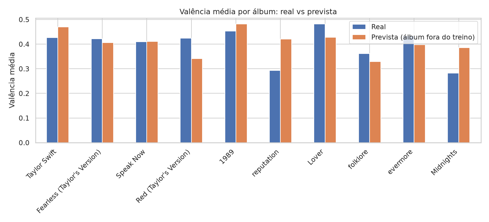

# Swiftlytics

A data science project that explores Taylor Swift's studio albums through Spotify audio features, built with Python and a bilingual scrollytelling site in HTML, CSS and vanilla JavaScript. It shows how the sound changes from era to era, tests how much of a song's mood (valence) can be predicted from audio alone, and checks whether lyrics add anything. The audio dataset has 191 songs and the lyrics cover 130 of them, so the results are exploratory.

**Live site:** https://laurvieira.github.io/swiftlytics/

## Features

- **Data cleaning:** removes the 3 bonus tracks without audio features and the empty lyrics column, leaving 191 songs, and fixes column types (`src/limpeza.py`).
- **Era analysis:** average valence, energy, acousticness and danceability per album in era order, plus a correlation heatmap (`src/eda.py`).
- **Valence model:** compares a mean baseline, Ridge regression and Random Forest with 5-fold cross-validation (`src/modelo_valencia.py`).
- **Album-level validation:** holds out entire albums to avoid optimistic scores and reports the Ridge coefficients (`src/avaliacao.py`).
- **Per-album test:** leave-one-album-out evaluation against a mean baseline (`src/por_album.py`).
- **Lyric features:** VADER sentiment, vocabulary diversity and line repetition, computed from lyrics that are never stored in the repository (`src/features_texto.py`, `src/modelo_texto.py`).
- **TF-IDF experiment:** adds up to 300 lyric terms to the audio model at three Ridge penalties (`src/modelo_tfidf.py`).
- **Dashboard:** Streamlit app to browse albums and compare actual vs predicted valence per song (`src/dashboard.py`).
- **Scrollytelling site:** eight scroll-driven chapters in English and Portuguese, with animated charts, a horizontal timeline of the ten eras, an album explorer and friendship-bracelet details (`docs/index.html`).

## Tech Stack

- **Python:** pandas and NumPy for data handling, with scikit-learn for the models and validation.
- **matplotlib and seaborn:** static figures saved to `reports/figures`.
- **vaderSentiment:** sentiment scores for the lyrics.
- **Streamlit:** local dashboard for browsing albums and songs.
- **HTML5, CSS3 and JavaScript (ES6+):** the site, with SVG charts, custom properties for light and dark themes and an EN/PT toggle.
- **GSAP and ScrollTrigger:** scroll-driven animations, loaded from a CDN.
- **GitHub Pages:** static hosting for the site, served from `docs/`.

## Getting Started

1. Clone the repository and enter the folder.
2. Create and activate a virtual environment, then install the dependencies:

   ```bash
   python3 -m venv .venv && source .venv/bin/activate
   pip install -r requirements.txt
   ```

3. Download the audio dataset:

   ```bash
   wget -P data/raw https://raw.githubusercontent.com/rfordatascience/tidytuesday/master/data/2023/2023-10-17/taylor_album_songs.csv
   ```

4. Run the audio experiments:

   ```bash
   python src/limpeza.py
   python src/eda.py
   python src/modelo_valencia.py
   python src/avaliacao.py
   python src/por_album.py
   ```

5. For the lyrics experiments, download the lyrics file (it is not versioned and stays out of Git through `.gitignore`), then run the text scripts:

   ```bash
   wget -O data/raw/taylor_swift_lyrics.csv https://raw.githubusercontent.com/rfordatascience/tidytuesday/master/data/2020/2020-09-29/taylor_swift_lyrics.csv
   python src/features_texto.py
   python src/modelo_texto.py
   python src/modelo_tfidf.py
   ```

6. Launch the dashboard:

   ```bash
   streamlit run src/dashboard.py
   ```

7. To publish the site, push the repository and enable GitHub Pages (Settings → Pages → `main` / `docs`).

## Results

- **Audio explains part of the mood:** Ridge reaches R² 0.33 with whole albums held out (191 songs), against 0.40 with shuffled folds. Random Forest reached 0.27 with shuffled folds. R² is the share of the variation in valence that the model explains, not an accuracy.
- **Error against the baseline:** with whole albums held out, the Ridge mean absolute error is 0.124, against 0.155 for predicting the mean.
- **Era patterns:** acousticness jumps in *folklore* (0.72) and *evermore* (0.79), *reputation* and *Midnights* combine the lowest valence with high danceability, and valence correlates with energy at 0.51.
- **Leave-one-album-out:** the model beats the mean baseline on 9 of 10 albums (error 0.125 vs 0.157), with *folklore* as the one tie. It overestimates the mood of *reputation* and *Midnights* (predicted about 0.42 and 0.39 vs actual about 0.29 and 0.28); a plausible but untested explanation is that high danceability reads as "happy" to an audio-only model.
- **Lyrics add no consistent gain:** on the 130 songs with lyrics (8 albums), simple features (VADER sentiment, vocabulary diversity, line repetition) lowered R² (0.10 vs 0.21 for audio only), and TF-IDF (300 terms, three Ridge penalties) matched or fell below audio only (0.15, 0.23 and 0.22 vs 0.21, 0.24 and 0.22).
- **Limitations:** small sample, folds with only 1-2 albums, lyrics that stop at *folklore*, and a Ridge penalty compared on the same data used for evaluation. Correlation is not causation, and prediction is not explanation.



## Author

Laura Vieira ([@LaurVieira](https://github.com/LaurVieira))